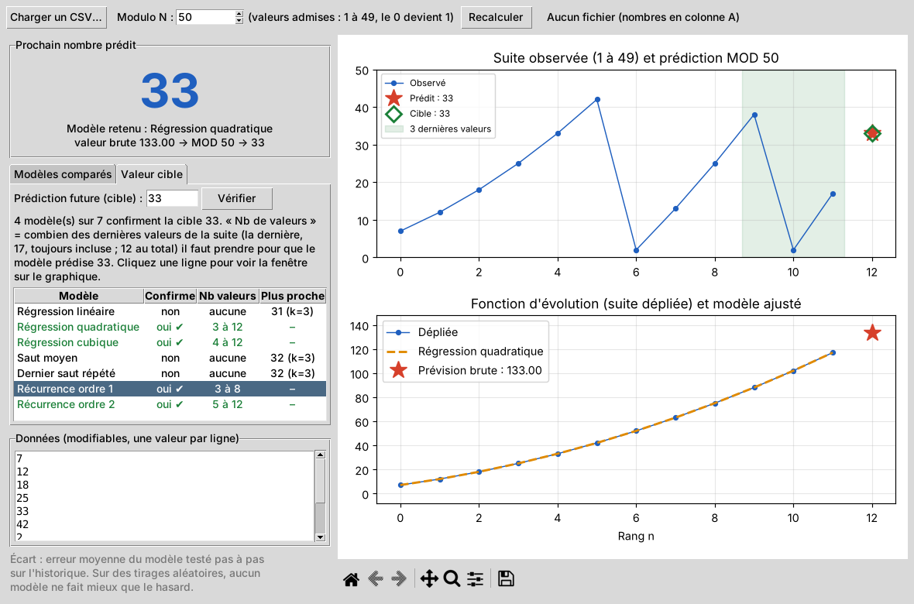

# Modulo49

Programme Windows qui modélise la fonction d'évolution d'une suite de nombres et prédit le nombre suivant avec la règle **MOD N**, N étant choisi par l'utilisateur (50 par défaut). Les valeurs admises vont de 1 à N-1 ; le résultat 0 n'est pas admis.

## Utilisation
1. Lancer **Modulo49**, choisir le **Modulo N** en haut de la fenêtre (flèches ou saisie + Entrée), puis cliquer sur **Charger un CSV…**.
2. Les nombres sont lus dans la **colonne A** (une ligne d'en-tête est tolérée ; séparateurs `;` `,` ou tabulation acceptés). Les lignes non numériques sont signalées et ignorées. Si une valeur dépasse N-1, le programme indique le N minimum à choisir.
3. Le programme affiche le **prochain nombre prédit**, le tableau des modèles et deux graphiques. La liste des données peut être modifiée à la main, puis **Recalculer**.

## Méthode
- **Dépliage** : chaque saut entre deux nombres est ramené modulo N dans ]-N/2 ; N/2] puis cumulé. Exemple avec N = 50 : 42 → 2 est lu comme +10 et non -40. On obtient une courbe continue, la « fonction d'évolution ».
- **Modèles ajustés** sur cette courbe : régressions linéaire, quadratique et cubique, saut moyen, dernier saut répété, récurrence d'ordre 1 u(n+1) = a·u(n) + b, récurrence d'ordre 2 u(n+1) = a·u(n) + b·u(n-1) + c.
- **Choix du modèle** : chaque modèle est testé pas à pas sur l'historique ; celui dont l'écart moyen avec les valeurs réelles est le plus faible est retenu (★). Cliquer sur une autre ligne du tableau affiche ce modèle sur le graphique.
- **MOD N** : la prévision brute est arrondie puis réduite modulo N. Si le résultat vaut 0, il est remplacé par **1** (valeur suivante du cycle). Changer N relance immédiatement tout le calcul.

## Calcul sur plusieurs colonnes
Bouton **Plusieurs colonnes…** (ou réponse « Oui » quand un CSV chargé contient plusieurs colonnes) : chaque colonne du fichier (A, B, C…) est une suite calculée séparément. Les colonnes peuvent avoir des longueurs différentes (les cellules vides sont ignorées) ; une ligne d'en-tête donne le nom des colonnes.

### Modulo choisi colonne par colonne (saisie libre)
Pour chaque colonne, tapez librement dans **N à calculer** les modulos voulus :
- une seule valeur : `50` ;
- plusieurs valeurs au choix : `37, 43, 50` (séparées par une virgule, un point-virgule ou un espace) ;
- une plage : `40-60` (ou `40 à 60`) = tous les N de 40 à 60 ;
- un mélange : `30-35, 50, 61, 70-72`.

La ligne **Toutes les colonnes** + **Appliquer à toutes** recopie la même saisie sur toutes les colonnes. La colonne **Calculs prévus** indique, pendant la frappe, les N qui seront calculés (ou l'erreur de saisie, en rouge). Un N trop petit pour la colonne (N ≤ sa plus grande valeur) ne peut pas être utilisé : il est ignoré et signalé. Une barre de progression suit le calcul ; **Arrêter** l'interrompt en gardant les résultats déjà obtenus.

### Résultats
- Onglet **Synthèse par colonne** : N calculés, N ignorés, **meilleur N** de la colonne, sa prédiction et son modèle, réussite, écart relatif, prédiction **la plus fréquente** sur tous les N calculés. Avec une **valeur cible** (facultative) : les N pour lesquels au moins un modèle la confirme, et le N où le plus de modèles sont d'accord (colonnes en vert si la cible est confirmée).
- Onglet **Détail par N** : une ligne par colonne et par N, avec la prédiction retenue, l'écart, la réussite, la prédiction majoritaire, la confirmation de la cible et la prédiction de chacun des 7 modèles (★ = meilleur N de la colonne).
- **Réussite** : part des prédictions exactes quand chaque modèle est testé pas à pas sur l'historique. **Écart relatif** : écart moyen divisé par N/2 (0 % = parfait, environ 50 % = hasard). Le **meilleur N** est celui de plus forte réussite, puis de plus petit écart relatif.
- **Exporter en CSV…** enregistre la synthèse puis tout le détail (s'ouvre dans Excel).
- Double-clic sur une ligne : la colonne s'ouvre dans la vue principale avec ce N (pour la synthèse : le meilleur N).

Exemples : `exemple_colonnes.csv` et `exemple_modulos.csv` (quatre suites construites avec des modulos différents : avec des plages de N, le programme retrouve 50, 37 et 43).

## Valeur cible (prédiction future)
Onglet **Valeur cible** : saisissez le nombre que vous attendez puis **Vérifier**. Pour chaque modèle, le programme indique :
- **Confirme** : oui si le modèle peut prédire cette cible ;
- **Nb valeurs** : combien des dernières valeurs de la suite il faut prendre pour que le modèle donne la cible. La dernière valeur est toujours incluse ; on remonte de k valeurs (ex. « 3 à 8 » = avec les 3, 4, … ou 8 dernières valeurs) ;
- **Plus proche** : si le modèle ne confirme pas, sa prédiction la plus proche de la cible et le k correspondant.

Cliquer sur une ligne surligne la fenêtre de valeurs utilisée sur le graphique. La cible est revérifiée automatiquement quand on change N ou les données.

## Récapitulatif exportable
Dans l'onglet **Valeur cible**, le bouton **Récapitulatif…** ouvre une fenêtre qui montre le point commun entre les méthodes :
- un **tableau** par modèle : confirme ou non, nombre de k qui donnent la cible, k min, k max, **étendue de la plage** (k max - k min + 1), plages de k, valeur la plus proche ;
- un **histogramme** : pour chaque k (nombre de dernières valeurs), combien de modèles confirment la cible ; les barres foncées marquent l'accord maximal ;
- une **carte des plages** : pour chaque modèle, les k qui donnent la cible (vert) ; la zone orange est commune à tous les modèles qui confirment.

Boutons d'export : **tableau en CSV** (s'ouvre directement dans Excel ; contient aussi le détail par k et la prédiction de chaque modèle pour chaque k) et **graphique en PNG ou PDF**.

## Limite importante
Pour une suite qui suit une loi (progression, accélération régulière…), la prédiction est exacte. Pour des **tirages aléatoires** (loto, etc.), aucun modèle ne peut prédire le nombre suivant mieux que le hasard : l'écart moyen affiché le montre.

## Télécharger
L'installateur est disponible dans les Releases : https://github.com/kbokimou-crypto/modulo49/releases/latest

## Construire le .exe et l'installateur (sur un PC Windows)
1. Installer Python 3.12 depuis python.org (cocher « Add Python to PATH »).
2. Facultatif : installer Inno Setup 6 (jrsoftware.org) pour obtenir un installateur.
3. Double-cliquer sur `construire.bat`.
   - Programme : `dist\Modulo49\Modulo49.exe`
   - Installateur : `installateur\Modulo49-Setup.exe`

Ou automatiquement : à chaque envoi sur `main`, le workflow `.github/workflows/build.yml` construit `Modulo49-Setup.exe` et le publie dans les **Releases** du dépôt.

## Fichiers
- `modulo49.py` : interface graphique · `moteur.py` : calculs et lecture CSV
- `modulo49.spec` : configuration PyInstaller · `installateur.iss` : script Inno Setup
- `construire.bat` : construction en un clic · `exemple.csv`, `exemple_colonnes.csv`, `exemple_modulos.csv` : données de test
