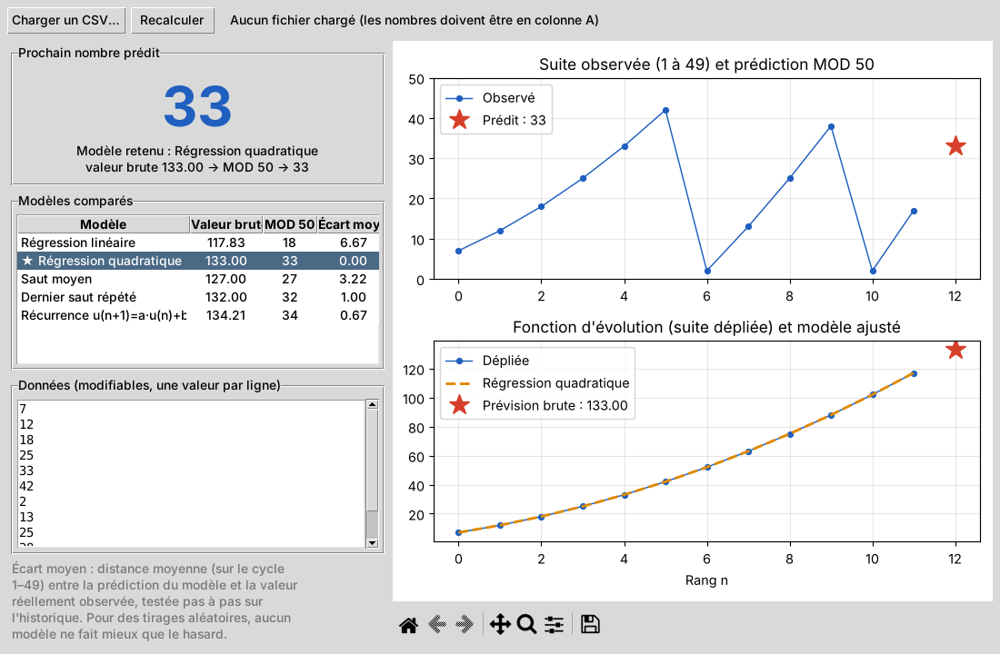

# Modulo49

Programme Windows qui modélise la fonction d'évolution d'une suite de nombres compris entre 1 et 49 et prédit le nombre suivant avec la règle MOD 50 (le résultat 0 n'est pas admis).

## Utilisation
1. Lancer **Modulo49**, cliquer sur **Charger un CSV…**.
2. Les nombres sont lus dans la **colonne A** (une ligne d'en-tête est tolérée ; séparateurs `;` `,` ou tabulation acceptés). Les valeurs hors 1–49 sont signalées et ignorées.
3. Le programme affiche le **prochain nombre prédit**, le tableau des modèles et deux graphiques. La liste des données peut être modifiée à la main, puis **Recalculer**.

## Méthode
- **Dépliage** : chaque saut entre deux nombres est ramené dans [-24 ; 25] modulo 50 puis cumulé. Exemple : 42 → 2 est lu comme +10 et non -40. On obtient une courbe continue, la « fonction d'évolution ».
- **Modèles ajustés** sur cette courbe : régression linéaire, régression quadratique, saut moyen, dernier saut répété, récurrence affine u(n+1) = a·u(n) + b.
- **Choix du modèle** : chaque modèle est testé pas à pas sur l'historique ; celui dont l'écart moyen avec les valeurs réelles est le plus faible est retenu (★). Cliquer sur une autre ligne du tableau affiche ce modèle sur le graphique.
- **MOD 50** : la prévision brute est arrondie puis réduite modulo 50. Si le résultat vaut 0, il est remplacé par **1** (valeur suivante du cycle).

## Limite importante
Pour une suite qui suit une loi (progression, accélération régulière…), la prédiction est exacte. Pour des **tirages aléatoires** (loto, etc.), aucun modèle ne peut prédire le nombre suivant mieux que le hasard : l'écart moyen affiché le montre.

## Télécharger
L'installateur est disponible dans les Releases : https://github.com/kbokimou-crypto/modulo49/releases/latest

## Construire le .exe et l'installateur (sur un PC Windows)
1. Installer Python 3.12 depuis python.org (cocher « Add Python to PATH »).
2. Facultatif : installer Inno Setup 6 (jrsoftware.org) pour obtenir un installateur.
3. Double-cliquer sur `construire.bat`.
   - Programme : `dist\Modulo49\Modulo49.exe`
   - Installateur : `installateur\Modulo49-Setup.exe`

Ou automatiquement : à chaque envoi sur `main`, le workflow `.github/workflows/build.yml` construit `Modulo49-Setup.exe` et le publie dans les **Releases** du dépôt.

## Fichiers
- `modulo49.py` : interface graphique · `moteur.py` : calculs et lecture CSV
- `modulo49.spec` : configuration PyInstaller · `installateur.iss` : script Inno Setup
- `construire.bat` : construction en un clic · `exemple.csv` : données de test
